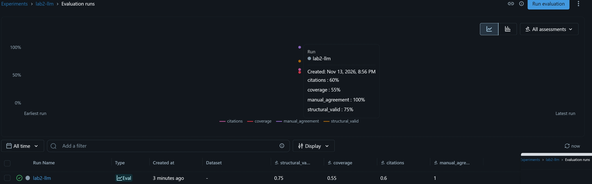

# Отчёт по ЛР 2
Траектория: AI и MLOps + LLM

## Этап А

### Требования
| Требование | Как реализовано |
|------------|-----------------|
| Корпус ≥ 30 сдач и ≥ 40 размеченных пар | `scripts/generate_corpus.py` |
|Происхождение варианта: assignment_id, family_id, derivation_relation, template_only| `domain/models.py: CorpusEntry, Pair` |
| Разные студенческие идентификаторы; ≥ 5 пар с разрешённым шаблоном | генератор `(student-{id}, template_only=True)` |
| Разделение семейств между настройкой и оценкой без утечки | `split_by_family()` (делит по family_id, оба конца пары в одном наборе) |
| Чтение JSONL через итератор, без загрузки всего корпуса | `sources/corpus_source.py: CorpusSource.iter_entries/iter_pairs` |
| Признаки через `tokenize` без комментариев и служебных токенов | `analyzers/similarity/token_utils.py: extract_tokens` |
| Отдельный учёт строк шаблона | `template_overlap` в `SimilarityReport` |
| Токеновые 3-граммы + Jaccard | `token_utils.py: ngrams, jaccard_similarity` |
| Сравнение одного задания разных студентов; self-match исключён; повторные версии отдельно | `services/similarity.py: compare_pairs, repeat_version_pairs` |
| Token baseline + TF-IDF с косинусным сходством | `token_baseline.py`, `tfidf_baseline.py` |
| Пары с основаниями: диапазоны строк + сведения о шаблоне | `SimilarityReport.evidence`, `template_overlap` |
| Fit только на наборе настройки; оценка без повторного fit | `tfidf_baseline.py: fit/_transform`, `scripts/similarity_pipeline.py` |
| ML: признаки пары | `ai/pair_features.py: PairFeatureExtractor` |
| LLM: retrieval кандидатов до генерации feedback | `ai/llm_retrieval.py: LLMRetrievalAnalyzer` |

### Приёмка этапа А

| Сценарий | Тест |
|----------|------|
| Точная копия получает максимальное непустое сходство | `test_similarity.py::test_identical_code_gets_max_similarity` |
| Общий шаблон не превращается в необъяснённое обвинение | `test_similarity.py::test_template_only_does_not_cause_false_accusation` |
| Пустые признаки/некорректный код - score=None | `test_empty_code_returns_none`, `test_syntax_error_returns_none` |
| top-k без самой работы и чужого задания | `test_ai_modules.py::test_llm_retrieval_excludes_self_and_pair`, `test_retrieval_excludes_different_assignment` |
| evidence указывает на существующие строки | `test_similarity.py::test_evidence_points_to_existing_lines` |

### Проверки

```bash
pip install -e .
python scripts/generate_corpus.py
pytest tests/test_corpus_split.py tests/test_similarity.py -q
python scripts/similarity_pipeline.py
```

### Ограничения

1. TemplateAnalyzer/similarity сравнивает строки целиком. Короткие общие строки засчитываются
2. TF-IDF словарь строится только на train. Токены test, отсутствующие в train, дают нулевые векторы
3. Корпус синтетический

## Этап Б

### Выполненные требования

| Требование | Как реализовано |
|------------|-----------------|
| Сравнение ≥ 2 методов на одинаковом фиксированном наборе | `scripts/run_evaluation.py` |
| Порог `review_required` выбран на наборе настройки | `evaluation/metrics.py: find_optimal_threshold` |
| Матрица ошибок, precision, recall, F1 на наборе оценки | `evaluation/metrics.py: compute_metrics, evaluate_method` |
| Доля неопределённых результатов | `EvaluationReport.undefined_ratio` |
| Разбор ≥ 3 ошибок, включая общий шаблон | `run_evaluation.py: analyze_errors` |
| Wall time и peak memory для 100/1000/5000; ≥ 3 запуска; медиана, среднее, seed, параметры | `scripts/profile_similarity.py` |
| Feedback по `rubric.json`: `criterion_id, status, evidence, explanation, review_required` | `llm/models.py`, `data/rubric.json` |
| Статусы `satisfied / not_satisfied / insufficient_evidence` | `llm/models.py: CriterionStatus` |
| Локальный baseline + заменяемая модель/stub | `llm/baseline.py`, `llm/clients.py` |
| ≥ 20 контрольных случаев | `scripts/llm_evaluation.py: build_cases`, `tests/test_llm_rubric.py` |
| Доля структурно валидных, покрытие критериев, корректность ссылок, ручная оценка | `llm/metrics.py: compute_llm_metrics` |
| Конфигурация и результаты в MLflow | `llm/mlflow_logger.py` |

### Контрольные примеры

| Сценарий | Тест |
|----------|------|
| Корректная цитата | `test_correct_citation`, `test_stub_valid_repeated` |
| Отсутствующий критерий | `test_missing_criterion` |
| Конфликт | `test_conflict` |
| Пустой ответ | `test_empty_response` |
| Неподтверждённая цитата | `test_unconfirmed_citation` |
| Инструкция внутри сдачи | `test_injection_is_data` |
| Невалидные структуры | `test_invalid_structures` |

### Обязательные проверки

| Проверка | Тест |
|----------|------|
| Одинаковый код | `test_identical_code_gets_max_similarity` |
| Переименованные переменные | `test_renamed_variables_still_similar` |
| Независимые решения | `test_independent_solutions_have_low_similarity` |
| Разрешённый шаблон | `test_template_only_does_not_cause_false_accusation` |
| Пустой ввод | `test_empty_code_returns_none`, `test_syntax_error_returns_none` |
| self-match | `test_mandatory_checks.py::test_self_match_excluded_by_service` |
| Повторная версия студента | `test_repeat_versions_tracked_separately`, `test_same_student_not_in_cross_reports` |
| Утечка семейств | `test_corpus_split.py::test_no_family_leakage` |
| AI: невалидный результат модели | `test_llm_rubric.py::test_invalid_structures`, `test_empty_response`, `test_conflict` |
| AI: воспроизводимость сохранённого эксперимента | `test_mandatory_checks.py::test_corpus_reproducible`, `test_saved_llm_experiment_reproducible` |

### Проверки

```bash
pytest -q
python scripts/run_evaluation.py
python scripts/profile_similarity.py    
```

### Измерения

1. Seed: 42
2. Запусков на конфигурацию: 3
3. Размеры: 100, 1000, 5000
4. Методы: token, tfidf
5. Метрики: медиана и среднее wall time и peak memory; min/max

Результаты в `out/profile_results.json`

| Записей | Пар | Метод | Time median, s | Time mean, s | Memory median, MB | Memory mean, MB |
| :--- | :--- | :--- | :--- | :--- | :--- | :--- |
| 100 | 200 | token | 0.26 | 0.28 | 0.05 | 0.08 |
| 100 | 200 | tfidf | 1.41 | 1.42 | 0.12 | 0.15 |
| 1000 | 2000 | token | 2.25 | 2.24 | 0.61 | 0.62 |
| 1000 | 2000 | tfidf | 14.44 | 16.90 | 0.75 | 0.75 |
| 5000 | 10000 | token | 23.40 | 23.43 | 3.29 | 3.35 |
| 5000 | 10000 | tfidf | 67.13 | 68.14 | 3.61 | 3.61 |

### Разбор ошибок

1. False Positive — общий шаблон. Независимые реализации с общим каркасом дают высокий template_overla. Сходство объясняется шаблоном, а не заимствованием
2. False Negative — переименование. Замена идентификаторов снижает Jaccard ниже порога
3. Undefined — пустой/некорректный код. score=None, результат не участвует в метриках и учитывается в undefined_ratio

### Ограничения

1. Порог выбран по max F1 на малом train
2. Профилирование последовательное
3. Нагрузочные записи синтетические и не используются для оценки качества
4. Реальный LLM не вызывается

### Скрин из mlflow


